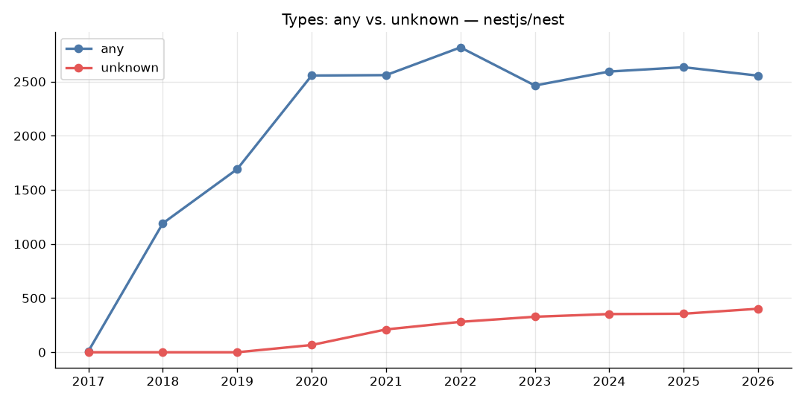

# Explorando evolução de código

Neste exercício, iremos explorar a evolução de código em sistemas reais.

Iremos utilizar a ferramenta [GitEvo](https://github.com/andrehora/gitevo).
Essa ferramenta analisa a evolução de código em repositórios Git nas linguagens Python, JavaScript, TypeScript e Java, e gera relatórios `HTML` como [este](https://andrehora.github.io/gitevo-examples/python/pandas.html).

Mais exemplos de relatórios podem ser podem ser encontrados em https://github.com/andrehora/gitevo-examples.

# Passo 1: Selecionar repositório a ser analisado

Selecione um repositório relevante na linguagem de sua preferência (Python, JavaScript, TypeScript ou Java).
Você pode encontrar projetos interessantes nos links abaixo:

- Python: https://github.com/topics/python?l=python
- JavaScript: https://github.com/topics/javascript?l=javascript
- TypeScript: https://github.com/topics/typescript?l=typescript
- Java: https://github.com/topics/java?l=java

# Passo 2: Instalar e rodar a ferramenta GitEvo

> [!NOTE]
> Antes de instalar a ferramenta, é recomendado criar e ativar um [ambiente virtual Python](https://packaging.python.org/en/latest/guides/installing-using-pip-and-virtual-environments/#create-and-use-virtual-environments).

Instale a ferramenta [GitEvo](https://github.com/andrehora/gitevo) com o comando:

```
$ pip install gitevo
```

Execute a ferramenta no repositório selecionado utilizando o comando abaixo (ajuste conforme a linguagem do repositório).
Substitua `<git_url>` pela URL do repositório que será analisado:

```shell
# Python
$ gitevo -r python <git_url>

# JavaScript
$ gitevo -r javascript <git_url>

# TypeScript
$ gitevo -r typescript <git_url>

# Java
$ gitevo -r java <git_url>
```

Por exemplo, para analisar o projeto Flask escrito em Python:

```
$ gitevo -r python https://github.com/pallets/flask
```

> [!NOTE]
> Essa etapa pode demorar alguns minutos pois o projeto será clonado e analisado localmente.

# Passo 3: Explorar o relatório de evolução de código

Após executar a ferramenta [GitEvo](https://github.com/andrehora/gitevo), é gerado um relatório `HTML` contendo diversos gráficos sobre a evolução do código.

Abra o relatório `HTML` e observe com atenção os gráficos.

# Passo 4: Explicar um gráfico de evolução de código

Selecione um dos gráficos de evolução e explique-o com suas palavras.
Por exemplo, você pode:

- Detalhar a evolução ao longo do tempo
- Detalhar se as curvas estão de acordo com boas práticas
- Explicar grandes alterações nas curvas
- Explorar a documentação do repositório em busca de explicações para grandes alterações
- etc.

Seja criativo!

# Instruções para o exercício

1. Crie um `fork` deste repositório (mais informações sobre forks [aqui](https://docs.github.com/pt/pull-requests/collaborating-with-pull-requests/working-with-forks/fork-a-repo)).
2. Adicione o relatório `HTML` no seu fork.
3. No Moodle, submeta apenas a URL do seu `fork`.

Responda às questões abaixo diretamente neste arquivo `README.md` do seu fork:

1. Repositório selecionado: https://github.com/nestjs/nest (relatório completo: [report_nest.html](report_nest.html), dados: [report_nest.csv](report_nest.csv))
2. Gráfico selecionado: **Types: any vs. unknown**

   

3. Explicação:

   O gráfico mostra, para cada ano (snapshot do início do ano), quantas vezes os tipos `any` e `unknown` aparecem no código TypeScript do NestJS. Os dois servem para representar "um valor de tipo qualquer", mas de formas bem diferentes: `any` desliga a checagem de tipos (dá para fazer qualquer operação no valor sem erro de compilação), enquanto `unknown` obriga o desenvolvedor a fazer uma verificação (`typeof`, `instanceof`, type guard etc.) antes de usar o valor. Por isso, a boa prática em TypeScript é preferir `unknown` a `any`.

   **Evolução ao longo do tempo**

   | Ano | LOC | `any` | `unknown` | `any` por 1.000 LOC | % `unknown` (entre `any` + `unknown`) |
   |-----|-----|-------|-----------|---------------------|---------------------------------------|
   | 2018 | 20.147 | 1.191 | 0 | 59,1 | 0% |
   | 2020 | 54.422 | 2.556 | 67 | 47,0 | 2,6% |
   | 2022 | 75.918 | 2.816 | 281 | 37,1 | 9,1% |
   | 2023 | 84.682 | 2.464 | 328 | 29,1 | 11,7% |
   | 2026 | 107.850 | 2.555 | 402 | 23,7 | 13,6% |

   - **2017–2020: crescimento rápido do `any`.** O projeto praticamente nasce nesse período (de 42 para mais de 1.000 arquivos `.ts`) e o número de `any` cresce junto. É compreensível: o NestJS é um framework baseado em decorators, injeção de dependência e reflexão (`reflect-metadata`), e muito código precisa lidar com objetos genéricos (providers, módulos, metadados, requisições de Express/Fastify). Além disso, `unknown` só passou a existir no TypeScript 3.0 (julho de 2018), então até 2019 a curva vermelha é zero.
   - **2020 em diante: `unknown` começa a ser adotado.** A curva vermelha surge em 2020 (67 ocorrências) e sobe de forma constante até 402 em 2026. No histórico de commits aparecem mudanças nessa direção, como `refactor(microservices): use MsPattern interface instead of any` (2019) e `feat(platform-express): replace any return type on #listen` (2022). Outro fator é a flag `useUnknownInCatchVariables` (TypeScript 4.4), que faz as variáveis de `catch` serem tipadas como `unknown` (houve commits ajustando essa flag em 2022).
   - **2020–2026: `any` estabiliza (e até cai).** É o ponto mais interessante: o código mais que dobra (54 mil → 108 mil LOC), mas o número absoluto de `any` fica praticamente estável em torno de 2.500. Ou seja, código novo quase não introduz `any`. A densidade cai de 47 para 24 `any` a cada 1.000 linhas, e há até uma queda absoluta de 2022 para 2023 (2.816 → 2.464), período que coincide com refactors de tipagem como `applicationConfig instead (instance as any).config` e a atualização do TypeScript 4.8 → 4.9.

   **Está de acordo com boas práticas?**

   Parcialmente. A tendência está correta: `any` cresce bem mais devagar que o código e `unknown` ganha espaço, o que mostra uma preocupação crescente com type safety. Mesmo assim, `any` ainda aparece cerca de 6x mais que `unknown` em 2026. Parte disso se explica pela natureza de um framework (APIs públicas genéricas, compatibilidade com várias bibliotecas e com versões antigas, código de testes com mocks), mas ainda há espaço para trocar `any` por `unknown` ou por generics. Uma regra de lint como `@typescript-eslint/no-explicit-any` ajudaria a acelerar essa transição.


